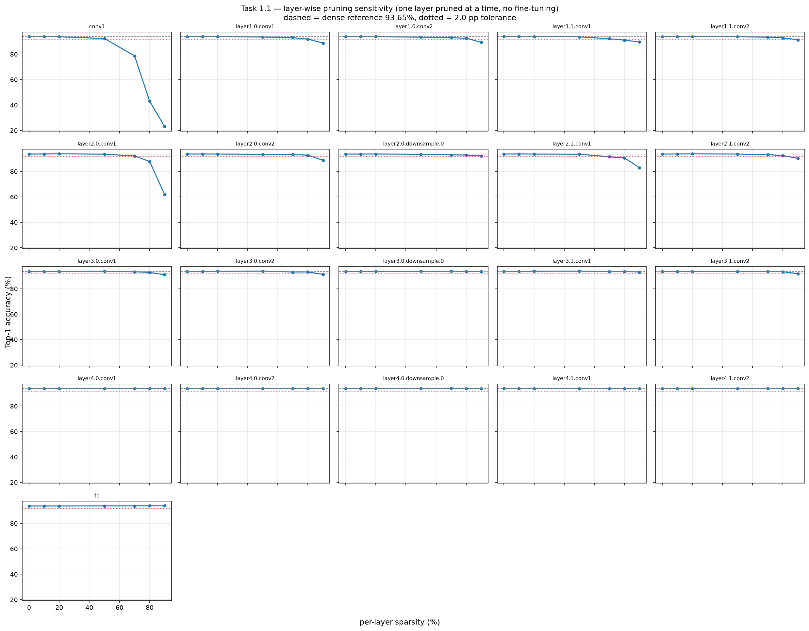
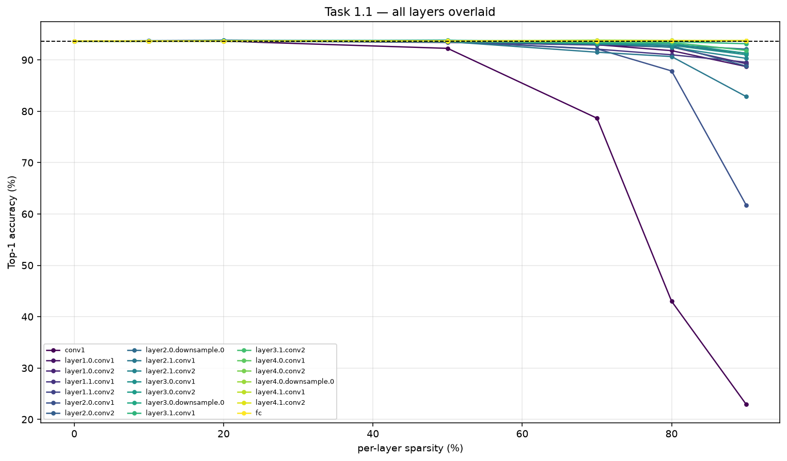
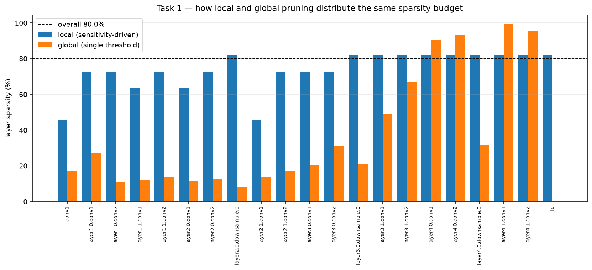
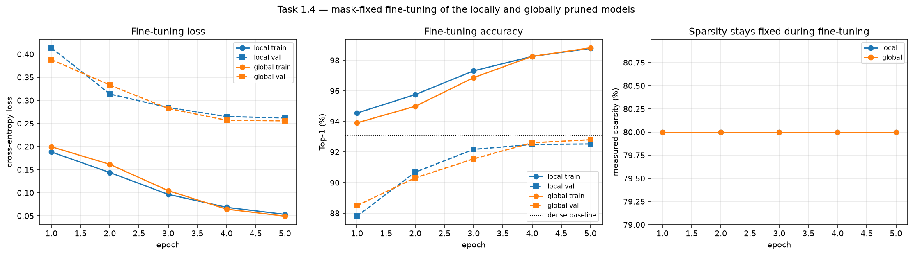
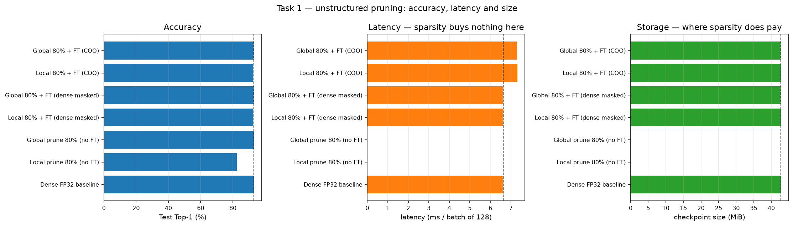
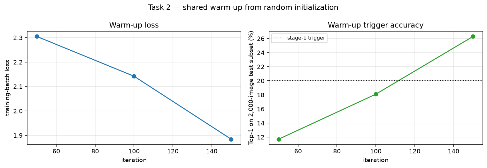
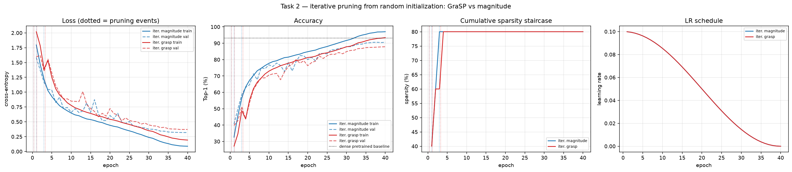
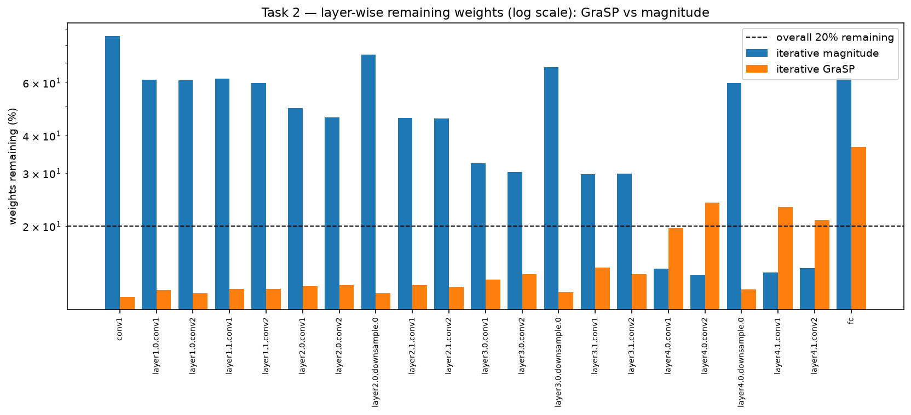
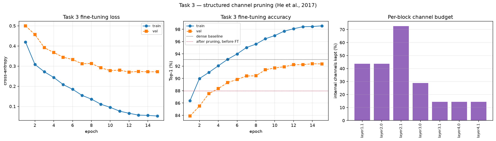
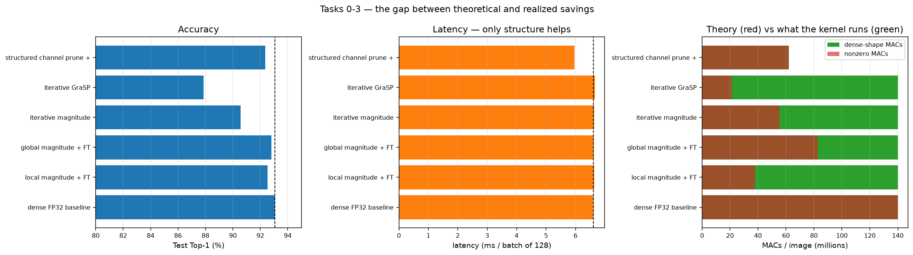

# AI624 PA-2 — Pruning ResNet-18 on CIFAR-10: Report

Muhammad Adnan · 25280067

## Setup and notes

* **Run.** All numbers come from one clean run of `PA2_25280067.ipynb` (29 September) on an RTX 3060 (12 GB), batch 128. Every model was profiled the same way: 50 untimed and 500 timed batches. Sizes and memory are in MiB (1024² bytes).
* **Cache.** Only the Task 1 sensitivity sweep was loaded from an earlier run of the same code (`artifacts/task1_sensitivity.csv`).
* **Generative AI.** I have used Claude (Claude Code, Opus) to analyse my code in this notebook and to help writing Latex where required.
* **Test set use.** No validation split was held out. The test set also drove decisions: a fixed 2,000 image test subset sets the Task 1 local pruning ratios and the Task 2 triggers, the "validation" curves use the full test set, and the fine tuning learning rate (0.001, not 0.01) was chosen on test accuracy.
  * Test accuracies are therefore optimistic by an unknown amount and are not unbiased estimates.
  * A held out training split would fix this for Task 2 only; the pretrained checkpoint (Tasks 1 and 3) saw all 50,000 training images.
* **Variation between runs.**
  * The unchanged dense model measured 6.61–6.72 ms per batch and 8.45–9.13 mJ per image over five runs: about 2 % and 8 % measurement noise.
  * Fine tuned accuracy varied up to 0.8 pp across development runs that also changed code, so that is not a noise level. Each configuration was run once; gaps of a few tenths of a point are not treated as meaningful.

## Main idea

| Quantity | Meaning |
|---|---|
| Sparsity | fraction of weights that are zero or removed |
| MACs | multiply accumulate operations, a proxy for compute |
| Latency, energy, bytes | what the hardware actually does |

Unstructured pruning changes the first, a theoretical version of the second, and not the third. Structured pruning changes all three.

## Task 0 — baseline

| Metric | Value |
|---|---|
| Test / train Top-1 | 93.07 % / 99.87 % |
| Test Top-5, macro-F1 | 99.74 %, 0.9307 |
| Parameters, size | 11,173,962, 42.70 MiB |
| MACs, FLOPs per image | 140.2 M, 280.4 M |
| Latency (batch 128) | 6.61 ms mean, 6.60 ms median |
| GPU memory: weights, forward pass, est. total | 42.7, 64.0, 108.2 MiB |
| Energy | 437.7 J GPU + 110.0 J CPU over 500 batches = 8.56 mJ/image |

* Test Top-1 matches the repository's 93.07 %, so the model, weights and preprocessing are correct.
* MACs: $C_\text{out} H_\text{out} W_\text{out} \cdot (C_\text{in}/g)\,k_h k_w$ per convolution, $d_\text{in} d_\text{out}$ for the linear layer; FLOPs $= 2\times$ MACs. Agrees with `thop` within 0.6 %.
* Memory is from the PyTorch allocator for this process. "Forward pass" means memory above the resident weights and input (mostly activations). NVML memory is device wide and kept for reference only.
* `layer4` holds about 75 % of the weights but only about a quarter of the MACs; each 3×3 convolution costs about 9.4 M MACs at every stage.

## Task 1 — unstructured pruning after training

**Method**

* Only `Conv2d` and `Linear` weights are pruned (11,164,352 of 11,173,962 parameters) to exactly $s^\star = 80\,\%$. Tensors keep their shape; only the number of nonzero weights falls.
* **Local:** each layer gets a tolerable sparsity $a_\ell$ (highest tested level with at most 2 pp drop), scaled by one factor $\alpha$:

$$r_\ell = \mathrm{clip}(\alpha\, a_\ell,\, 0.05,\, 0.95), \qquad \frac{\sum_\ell r_\ell N_\ell}{\sum_\ell N_\ell} = s^\star .$$

* **Global:** one magnitude threshold $\tau$ for all layers, with $\#\{|w| < \tau\} = s^\star \sum_\ell N_\ell$.
* **Fine tuning:** SGD, lr 0.001 cosine, momentum 0.9, weight decay $5\times10^{-4}$, 5 epochs, seed 42, same seeded data loader for both models. The mask is applied after every step ($W \leftarrow M \odot W$); all masked weights were verified to be exactly zero afterwards.

**1.1 Most sensitive layers** (single layer pruned to 90 %, no fine tuning)

| Most sensitive | Δ Top-1 | Least sensitive | Δ Top-1 |
|---|---|---|---|
| `conv1` (1,728 weights) | **−70.75 pp** | `layer4.0.downsample.0` | +0.05 pp |
| `layer2.0.conv1` | −31.95 pp | `layer4.0.conv1` | +0.10 pp |
| `layer2.1.conv1` | −10.80 pp | `layer4.0.conv2` (2.36 M weights) | +0.10 pp |
| `layer1.0.conv1` | −4.95 pp | `layer4.1.conv2` | +0.10 pp |
| `layer2.0.conv2` | −4.85 pp | `fc` | +0.10 pp |

* 0.1 pp on a 2,000 image subset is 2 images, so the right column means no measurable loss.
* Likely reason: wide layers such as `layer4` (512 channels, 10 classes) have spare capacity; small early layers do not, and feed every later layer.
* So pruning every layer to 80 % would be a poor choice.

**1.2 Was global pruning's layer distribution reasonable?**

| Layer | Local | Global |
|---|---|---|
| `conv1` | 45.4 % | **17.0 %** |
| `layer1.*` | 64–73 % | **11–27 %** |
| `layer3.1.conv2` | 81.7 % | 66.7 % |
| `layer4.1.conv1` | 81.7 % | **99.4 %** |
| `fc` | 81.7 % | **0.16 %** |

* **For accuracy, yes.** Without seeing the sweep, it spared the early layers and pruned `layer4` hardest. It reached **93.11 %** with no fine tuning (dense 93.07 %); local reached 82.42 %.
* **For compute, no:**

| | Effective MACs | Fraction of dense | Top-1 after FT |
|---|---|---|---|
| Dense | 140.2 M | 100 % | 93.07 % |
| **Local** | **37.8 M** | **27 %** | 92.52 % |
| Global | 82.7 M | 59 % | 92.80 % |

* Local removes 1.78× more MACs (102.3 M vs 57.5 M) and leaves 2.2× fewer, because it also thins the early, MAC heavy layers.
* Risk: global pruning reserves no minimum per layer (`layer4.1.conv1` reached 99.41 %). No layer emptied at 80 %, but nothing prevents it at higher sparsity.

**1.3 Accuracy recovered by fine tuning**

| | Before FT | After FT | Change | vs dense |
|---|---|---|---|---|
| Local | 82.42 % | 92.52 % | **+10.10 pp** | −0.55 pp |
| Global | 93.11 % | 92.80 % | −0.31 pp | −0.27 pp |

* Local pruning did real damage and fine tuning recovered almost all of it.
* Global pruning did almost none, so there was nothing to recover; it does not need fine tuning at 80 %.
* The 0.28 pp gap between them cannot be ranked from single runs.
* **Learning rate:** with lr 0.01 (archived in `artifacts/lr0.01_runs/task1_lr0.01/`) global fell to **87.06 %** and local reached only 91.53 %. A large rate pushes a good model away from its solution.

**1.4 Did COO storage reduce model size?** No; the required format doubled it.

| Format (local model) | Size | vs dense |
|---|---|---|
| Dense `.pt` | 42.70 MiB | 1.00× |
| gzip of dense `.pt` | 10.60 MiB | 0.25× |
| **COO int64 + masks (required)** | **87.41 MiB** | **2.05× larger** |
| COO int64, no masks | 76.76 MiB | 1.80× |
| COO int32, no masks | 42.70 MiB | 1.00× |
| COO int16 (theory) | 25.55 MiB | 0.60× |

* Dense costs 4 bytes per weight. COO with `int64` indices costs $4 + 4\times 8 = 36$ bytes per nonzero for a 4D weight, so it only wins when

$$36\,(1-s) < 4 \iff s > 88.9\,\%.$$

* With `int32` indices break even is exactly 80 %, matching the measured size (42.698 vs 42.702 MiB).
* Masks add about 11 MiB and can be rebuilt from the COO indices.
* gzip (10.60 MiB local, 9.88 MiB global) is 4.0× smaller than COO `int32` and 2.4× smaller than theoretical `int16` COO.

**1.5 Why zeros do not reduce latency**

| Model | Latency (batch 128) | vs dense |
|---|---|---|
| Dense | 6.61 ms | 1.00× |
| Dense masked (80 % zeros) | 6.63 ms | 1.00× |
| COO (`int64` indices) | 7.32 ms | **1.11× slower** |

* Effective MACs fell 3.7× (140.2 M → 37.8 M), but latency did not move (+0.2 %, within noise).
* The dense cuDNN kernel multiplies every weight; a zero costs the same.
* Scattered zeros give the GPU nothing to skip. It needs structure: 2:4 sparsity, or whole channels (Task 3).
* COO adds work: each forward pass calls `.to_dense()` before the same dense convolution, and holds 76.7 MiB of weights instead of 42.7 MiB. Only `fc` (5,120 weights) uses a real sparse matmul.
* The 11 % COO slowdown is well above the ~2 % noise; masked vs dense differences are not.

## Task 2 — iterative pruning from random weights

**Setup**

* One shared warm up from random weights (replaced 3×3 stem initialized Kaiming normal, fan out, as in the reference repository). Both methods then continue from identical weights, a copy of the same optimizer state and the same seeded data loader, so they see identical batches.
* 40 epochs, SGD lr 0.1 cosine. Three cumulative stages, $s_1 = 0.5 s^\star$, $s_2 = 0.75 s^\star$, $s_3 = s^\star$, triggered at about 20 %, 40 %, 60 % test subset accuracy. Masks only grow: $M_{\text{cum},k} = M_{\text{cum},k-1} \odot M_k$. Both criteria are global.
* The warm up stopped at **26.30 %** after 150 iterations (below 20 % at iteration 100; the trigger is checked every 50 iterations), overshooting the ~20 % target. Curves: `artifacts/figures/task2_warmup.png`.

**2.1 GraSP score**

With $\mathbf g$ the gradient of the average calibration loss and $\mathbf H$ the Hessian, removing weights by $\boldsymbol\delta$ changes gradient flow to first order by

$$\Delta \lVert \nabla \mathcal L \rVert^2 \approx 2\,\boldsymbol\delta^\top \mathbf H \mathbf g, \qquad \delta_i = -\theta_i \;\Rightarrow\; S_i = -\theta_i\,(\mathbf{Hg})_i .$$

* The highest $S_i$ are removed (as in the paper's code).
* $\mathbf{Hg}$ uses two autograd passes, no explicit Hessian. At stages 2 and 3, $\mathbf g$ is masked to the surviving weights.

**Is the sign right?** Yes, where the first order formula applies.

* **Small perturbation check.** The top 1 % and bottom 1 % $S$ weights were shrunk by $\varepsilon$; predicted $\Delta G = 2\varepsilon\sum_{i\in P} S_i$:

| Weights shrunk | $\varepsilon$ | Predicted $\Delta G$ | Actual $\Delta G$ | Actual / predicted |
|---|---|---|---|---|
| highest $S$ | 0.001 | +1.45e-6 | +2.06e-6 | 1.42 |
| highest $S$ | 0.01 | +1.45e-5 | +1.52e-5 | **1.05** |
| highest $S$ | 0.1 | +1.45e-4 | +2.29e-5 | 0.16 |
| highest $S$ | 1 | +1.45e-3 | −1.10e-5 | −0.01 |
| lowest $S$ | 0.001 | −1.47e-6 | −1.67e-6 | 1.13 |
| lowest $S$ | 0.01 | −1.47e-5 | −1.19e-5 | **0.81** |
| lowest $S$ | 0.1 | −1.47e-4 | −2.79e-5 | 0.19 |
| lowest $S$ | 1 | −1.47e-3 | −3.79e-5 | 0.03 |

  * For small $\varepsilon$ the sign and size match; from $\varepsilon = 0.1$ the formula fails.
* **One shot 80 % check.** Pruning to 80 % at once gave 2.82× the dense gradient flow for the paper's direction and 0.38× for the reverse in this run, but the opposite order (1.25× vs 6.26×) in the previous run. 80 % at once is far outside the first order range, so this check is not reliable.

**2.2 Did iterative pruning beat one shot magnitude pruning?**

* Iterative magnitude from scratch: **90.57 %**; Task 1 one shot global: **92.80 %**.
* The 2.2 pp gap mostly reflects the start (trained vs random), not iterating. A fair test (one shot pruning of the same random start, same budget) is not in the brief.
* Gradual magnitude pruning barely hurt each step: **+0.70, −1.40, 0.00 pp**.

**2.3 Did GraSP beat iterative magnitude?** No.

* GraSP **87.85 %**, magnitude **90.57 %** (gap 2.72 pp; train 95.08 % vs 98.01 %). One run each, so the exact gap is uncertain.

| Stage | Magnitude: before → after | GraSP: before → after |
|---|---|---|
| 1 (40 %) | 26.30 → 27.00 % | 26.30 → **9.80 %** |
| 2 (60 %) | 43.30 → 41.90 % | 43.40 → **4.75 %** |
| 3 (80 %) | 63.45 → 63.45 % | 60.40 → **9.80 %** |

* Every GraSP step drops accuracy to chance (about 10 %), then training recovers it.
* **Not a BatchNorm effect.** A copy of the model with BatchNorm statistics recomputed on 2,560 training images:

| Stage | Magnitude after: BN as is → fresh | GraSP after: BN as is → fresh |
|---|---|---|
| 1 | 27.00 → 27.50 % | 9.80 → **9.30 %** |
| 2 | 41.90 → 41.55 % | 4.75 → **8.80 %** |
| 3 | 63.45 → 64.15 % | 9.80 → **7.75 %** |

  * GraSP stays at chance; the control (unpruned model, fresh statistics) moves by at most 1.7 pp. The collapse comes from the removed weights.
* Plausible reason: GraSP preserves gradient flow, not the current output. These agree at initialization but not after training, and GraSP also removes some large weights. Magnitude pruning tends to preserve the output.
* **Cost:** GraSP's criterion took 0.711 s vs 0.0060 s (about 118×, CUDA synchronized), only 0.15 % of the 7.7 minute run. Accuracy, not cost, is the reason to prefer magnitude.
* **Effective MACs:** GraSP 21.2 M vs magnitude 55.6 M. GraSP keeps 12–15 % of every `layer1`–`layer3` convolution (about 9.4 M MACs each); magnitude keeps 30–62 % and prunes `layer4` hardest. Latency is the same (about 6.6 ms).

**2.4 Did any layer collapse?** No.

| | Thinnest layer | Weights left | `conv1` left |
|---|---|---|---|
| Magnitude | `layer4.0.conv2` | 13.7 % | 85.7 % |
| GraSP | `conv1` | 11.6 % | 11.6 % |

* GraSP thins `conv1`, the most sensitive layer in Task 1, which may explain part of its lower accuracy.
* Global criteria reserve no minimum per layer. A fully pruned block would silently become its shortcut, so the notebook checks per layer ratios.

## Task 3 — structured channel pruning

**Method**

* Prune each block's **internal** channels (output of `conv1` = input of `conv2`), so no tensor feeding a residual addition changes width. The stem and `layer1.0` are not pruned; `fc` stays dense.
* A block keeping a fraction $r$ of its channels keeps about $r$ of its weights. Unpruned layers keep all theirs, so pruned blocks keep under 20 % on average; the largest keep 14.5 %.
* Blocks are pruned in order, each using 2,048 calibration images passed through the already pruned network:
  1. `F.unfold` turns the convolution into $Y = X_\text{unf} W_\text{mat}$ (checked against the real output).
  2. **LASSO** selects channels: $\hat\beta = \arg\min_\beta \frac{1}{2N}\lVert Y - \sum_i \beta_i Z_i \rVert_F^2 + \lambda \lVert\beta\rVert_1$, raising $\lambda$ until $c_0$ values are nonzero.
  3. **Least squares** refits the weights: $W' = \arg\min_{W'} \lVert Y - X' W'^\top \rVert_F^2$, with $\beta$ folded in.
* The LASSO is solved on a $c\times c$ Gram form, $\lVert D\beta - D\mathbf 1\rVert^2$ with $D^\top D = G$, $G_{ij} = \langle Z_i, Z_j\rangle$, instead of about a billion rows.
* Changes from the textbook LASSO: $\beta \ge 0$, and a ridge $\epsilon I$ ($\epsilon = 10^{-6}\times$ mean diagonal of $G$) that adds $\epsilon\lVert\beta - \mathbf 1\rVert^2$.
* Every final fit converged (`layer4.1` after a retry, 9,865 iterations). `layer4.1` kept 73 nonzero coefficients, so its 74th channel was added with $\beta = 0$ and trained only during fine tuning.

**Reconstruction quality**

| Block | Channels | Relative residual |
|---|---|---|
| `layer1.1` | 64 → 28 | 0.0991 |
| `layer2.0` | 128 → 56 | 0.0690 |
| `layer2.1` | 128 → 93 | 0.0292 |
| `layer3.0` | 256 → 74 | 0.0723 |
| `layer3.1` | 256 → 37 | 0.0187 |
| `layer4.0` | 512 → 74 | **0.00018** |
| `layer4.1` | 512 → 74 | **0.00004** |

* On the calibration data, `layer4` outputs are almost exactly rebuilt from 14.5 % of their inputs. This holds for this network and these images, not in general.

**Did performance improve within the accuracy limit?** Yes, and only here.

| Quantity | Dense | Structured | Change |
|---|---|---|---|
| Parameters | 11,173,962 | 2,222,386 | **−80.1 %** |
| MACs / image | 140.2 M | 62.0 M | **−55.8 %** |
| **Latency, median** | 6.60 ms | 5.06 ms | **1.30× faster** |
| Latency, mean | 6.61 ms | 5.96 ms | 1.11× (one stall) |
| **Checkpoint** | 42.70 MiB | 8.54 MiB | **−80.0 %** |
| **Weight memory** | 42.7 MiB | 8.5 MiB | **−80.1 %** |
| Forward pass memory | 64.0 MiB | 64.0 MiB | unchanged |
| **Est. total memory** | 108.2 MiB | 74.0 MiB | **−31.6 %** |
| **Energy** | 8.56 mJ/img | 6.73 mJ/img | **−21.4 %** |
| Test Top-1 | 93.07 % | 92.37 % | −0.70 pp |

* **Latency note:** one of the 500 timed iterations stalled (std 13.7 ms vs 0.10 ms dense), inflating the mean. The median matches the same architecture before fine tuning (5.07 ms) and earlier runs (1.26–1.28×). The stall also inflates energy a little (6.22 mJ/image before fine tuning).
* **Accuracy:** −0.70 pp, well within 5–15 pp; better than both Task 2 models while 5× smaller.
* **Why it works:** Tasks 1 and 2 kept tensor shapes, so zeros were still multiplied. Here the tensors are smaller (512 → 74 channels). MACs and effective MACs are both 62.0 M; nothing is wasted.
* **Memory:** the forward pass still needs 64 MiB because the peak comes from the unpruned stem (32×32×64 output); pruned blocks run at 16×16 and below.
* **Latency vs MACs:** −23 % vs −56 %. Smaller layers use the GPU less efficiently.
* **Cost:** before fine tuning the model scored 87.97 % (global unstructured: 93.11 %), because removing a channel removes a whole feature. Fine tuning (lr 0.001, 15 epochs, 3.0 min) gave **92.37 %** (+4.40 pp).
* **Learning rate:** with lr 0.01 (archived in `artifacts/lr0.01_runs/task3_lr0.01/`) accuracy fell to 57.79 % after one epoch and ended at **86.45 %**, below where it started, a 5.9 pp difference.

## Conclusions

* **Sparsity is not a deployment metric.** All methods reached 80 %, yet latency ranged from 1.11× slower (COO) to 1.30× faster (structured, median) and size from 2.05× larger to 5.0× smaller.
* **The best method depends on the goal:**

| Goal | Best choice | Result |
|---|---|---|
| Accuracy at 80 %, no retraining | global unstructured, no fine tuning | 93.11 % |
| Disk size | structured, or gzip of the dense model | 8.54 MiB / 9.9–10.6 MiB |
| Latency, energy, memory | **structured** (nothing else helped) | 1.30× faster, −21 % energy |
| Theoretical compute | local unstructured or GraSP | 37.8 M / 21.2 M effective MACs |

* **ResNet-18 has much spare capacity for CIFAR-10:** pruning 90 % of `layer4.0.conv2` alone costs nothing measurable, global 80 % pruning costs nothing, and `layer4` outputs are rebuilt from 14.5 % of their inputs.
* **Know the noise:** about 2 % latency and 8 % energy for the same model. The 1.30× speedup and 1.11× COO slowdown are real; small energy and accuracy differences are not. Report medians, since one stall can distort a mean.
* **Check what fails silently:** a missing max pool that still loaded with `strict=True` (21 % instead of 93 %), a training loop left in `eval()` mode, a learning rate that damaged the model, and a gradient flow diagnostic that measured the wrong quantity. End to end checks against a known number (93.07 %) caught these.

## Appendix A — figures

All figures are in `artifacts/figures/` and in the notebook.

| Figure | Contents |
|---|---|
|  | Task 1.1 — per layer sensitivity |
|  | Task 1.1 — all sensitivity curves |
|  | Task 1.3 — local vs global sparsity per layer |
|  | Task 1.4 — fine tuning curves |
|  | Task 1 — accuracy vs cost |
|  | Task 2.5 — warm up curves |
|  | Task 2 — training curves with pruning steps |
|  | Task 2 — remaining weights per layer |
|  | Task 3 — fine tuning curves and channel budgets |
|  | All tasks — accuracy, latency, MACs |

## Appendix B — full result tables

Generated by the notebook (`artifacts/report_tables.md`).

* *COO int32 size, no masks* is the smallest COO file; the required format (COO `int64` + masks) is about 87.4 MiB, and the COO models timed here use `int64` indices.
* *Params* is the allocated count; unstructured pruning reduces only *Params (nonzero)*.
* Memory columns are allocator figures for this process; "above weights+input" excludes the resident weights and input.

#### Task 0 — data and preprocessing configuration

|                    | value                                              |
|:-------------------|:---------------------------------------------------|
| dataset            | CIFAR-10                                           |
| train_images       | 50000                                              |
| test_images        | 10000                                              |
| input_resolution   | 32x32x3                                            |
| train_batch_size   | 128                                                |
| eval_batch_size    | 256                                                |
| profile_batch_size | 128                                                |
| normalization_mean | (0.4914, 0.4822, 0.4465)                           |
| normalization_std  | (0.2471, 0.2435, 0.2616)                           |
| train_augmentation | RandomCrop(32, padding=4) + RandomHorizontalFlip() |
| eval_augmentation  | none (ToTensor + Normalize only)                   |
| dataloader_workers | 8                                                  |

#### Task 0 — dense FP32 baseline

|                                           |   Dense FP32 baseline |
|:------------------------------------------|----------------------:|
| Train Top-1 (%)                           |            99.87      |
| Test Top-1 (%)                            |            93.07      |
| Test Top-5 (%)                            |            99.74      |
| Test macro-F1                             |             0.9307    |
| Parameters                                |             1.117e+07 |
| Model size (MiB)                          |            42.7       |
| MACs / image                              |             1.402e+08 |
| FLOPs / image                             |             2.804e+08 |
| Latency (ms / batch of 128)               |             6.615     |
| Latency (ms / image)                      |             0.05168   |
| Peak GPU memory above weights+input (MiB) |            64         |
| Avg GPU memory above weights+input (MiB)  |            11.35      |
| Model weights resident (MiB)              |            42.66      |
| Est. total inference GPU memory (MiB)     |           108.2       |
| GPU energy (J / 500 batches)              |           437.7       |
| CPU energy (J / 500 batches)              |           110         |
| Energy (mJ / image)                       |             8.557     |

#### Task 0 — per layer parameter and MAC breakdown

| layer                 | type   | shape            |   params |   % of prunable params |   MACs / image |
|:----------------------|:-------|:-----------------|---------:|-----------------------:|---------------:|
| conv1                 | Conv2d | (64, 3, 3, 3)    |     1728 |                0.01548 |      1.769e+06 |
| layer1.0.conv1        | Conv2d | (64, 64, 3, 3)   |    36864 |                0.3302  |      9.437e+06 |
| layer1.0.conv2        | Conv2d | (64, 64, 3, 3)   |    36864 |                0.3302  |      9.437e+06 |
| layer1.1.conv1        | Conv2d | (64, 64, 3, 3)   |    36864 |                0.3302  |      9.437e+06 |
| layer1.1.conv2        | Conv2d | (64, 64, 3, 3)   |    36864 |                0.3302  |      9.437e+06 |
| layer2.0.conv1        | Conv2d | (128, 64, 3, 3)  |    73728 |                0.6604  |      4.719e+06 |
| layer2.0.conv2        | Conv2d | (128, 128, 3, 3) |   147456 |                1.321   |      9.437e+06 |
| layer2.0.downsample.0 | Conv2d | (128, 64, 1, 1)  |     8192 |                0.07338 |      5.243e+05 |
| layer2.1.conv1        | Conv2d | (128, 128, 3, 3) |   147456 |                1.321   |      9.437e+06 |
| layer2.1.conv2        | Conv2d | (128, 128, 3, 3) |   147456 |                1.321   |      9.437e+06 |
| layer3.0.conv1        | Conv2d | (256, 128, 3, 3) |   294912 |                2.642   |      4.719e+06 |
| layer3.0.conv2        | Conv2d | (256, 256, 3, 3) |   589824 |                5.283   |      9.437e+06 |
| layer3.0.downsample.0 | Conv2d | (256, 128, 1, 1) |    32768 |                0.2935  |      5.243e+05 |
| layer3.1.conv1        | Conv2d | (256, 256, 3, 3) |   589824 |                5.283   |      9.437e+06 |
| layer3.1.conv2        | Conv2d | (256, 256, 3, 3) |   589824 |                5.283   |      9.437e+06 |
| layer4.0.conv1        | Conv2d | (512, 256, 3, 3) |  1179648 |               10.57    |      4.719e+06 |
| layer4.0.conv2        | Conv2d | (512, 512, 3, 3) |  2359296 |               21.13    |      9.437e+06 |
| layer4.0.downsample.0 | Conv2d | (512, 256, 1, 1) |   131072 |                1.174   |      5.243e+05 |
| layer4.1.conv1        | Conv2d | (512, 512, 3, 3) |  2359296 |               21.13    |      9.437e+06 |
| layer4.1.conv2        | Conv2d | (512, 512, 3, 3) |  2359296 |               21.13    |      9.437e+06 |
| fc                    | Linear | (10, 512)        |     5120 |                0.04586 |   5120         |

#### Task 1.1 — layerwise sensitivity: Top-1 (%) vs per layer sparsity, no fine tuning

| layer                 |   0.0 |   0.1 |   0.2 |   0.5 |   0.7 |   0.8 |   0.9 |
|:----------------------|------:|------:|------:|------:|------:|------:|------:|
| conv1                 | 93.65 | 93.65 | 93.65 | 92.25 | 78.65 | 43.00 | 22.90 |
| layer1.0.conv1        | 93.65 | 93.65 | 93.65 | 93.50 | 92.95 | 91.80 | 88.70 |
| layer1.0.conv2        | 93.65 | 93.65 | 93.65 | 93.40 | 92.90 | 92.50 | 89.25 |
| layer1.1.conv1        | 93.65 | 93.65 | 93.75 | 93.60 | 92.10 | 91.00 | 89.55 |
| layer1.1.conv2        | 93.65 | 93.65 | 93.70 | 93.65 | 93.35 | 92.85 | 91.30 |
| layer2.0.conv1        | 93.65 | 93.70 | 93.85 | 93.55 | 92.15 | 87.85 | 61.70 |
| layer2.0.conv2        | 93.65 | 93.70 | 93.65 | 93.50 | 93.30 | 92.75 | 88.80 |
| layer2.0.downsample.0 | 93.65 | 93.65 | 93.70 | 93.50 | 93.00 | 92.90 | 92.10 |
| layer2.1.conv1        | 93.65 | 93.75 | 93.65 | 93.55 | 91.50 | 90.65 | 82.85 |
| layer2.1.conv2        | 93.65 | 93.70 | 93.80 | 93.65 | 93.20 | 92.45 | 90.30 |
| layer3.0.conv1        | 93.65 | 93.65 | 93.65 | 93.75 | 93.30 | 92.85 | 91.00 |
| layer3.0.conv2        | 93.65 | 93.65 | 93.70 | 93.85 | 93.15 | 93.20 | 91.30 |
| layer3.0.downsample.0 | 93.65 | 93.65 | 93.65 | 93.70 | 93.70 | 93.60 | 93.65 |
| layer3.1.conv1        | 93.65 | 93.65 | 93.75 | 93.80 | 93.60 | 93.55 | 93.15 |
| layer3.1.conv2        | 93.65 | 93.65 | 93.65 | 93.60 | 93.45 | 93.40 | 91.85 |
| layer4.0.conv1        | 93.65 | 93.65 | 93.65 | 93.70 | 93.75 | 93.75 | 93.75 |
| layer4.0.conv2        | 93.65 | 93.65 | 93.65 | 93.65 | 93.70 | 93.70 | 93.75 |
| layer4.0.downsample.0 | 93.65 | 93.65 | 93.65 | 93.70 | 93.85 | 93.80 | 93.70 |
| layer4.1.conv1        | 93.65 | 93.65 | 93.65 | 93.65 | 93.65 | 93.70 | 93.65 |
| layer4.1.conv2        | 93.65 | 93.65 | 93.65 | 93.65 | 93.65 | 93.70 | 93.75 |
| fc                    | 93.65 | 93.65 | 93.65 | 93.70 | 93.70 | 93.75 | 93.75 |

#### Task 1.1 — accuracy drop (pp) at 90% single layer sparsity, most sensitive first

| layer                 |   Top-1 drop (pp) |
|:----------------------|------------------:|
| conv1                 |             70.75 |
| layer2.0.conv1        |             31.95 |
| layer2.1.conv1        |             10.80 |
| layer1.0.conv1        |              4.95 |
| layer2.0.conv2        |              4.85 |
| layer1.0.conv2        |              4.40 |
| layer1.1.conv1        |              4.10 |
| layer2.1.conv2        |              3.35 |
| layer3.0.conv1        |              2.65 |
| layer1.1.conv2        |              2.35 |
| layer3.0.conv2        |              2.35 |
| layer3.1.conv2        |              1.80 |
| layer2.0.downsample.0 |              1.55 |
| layer3.1.conv1        |              0.50 |
| layer3.0.downsample.0 |              0.00 |
| layer4.1.conv1        |              0.00 |
| layer4.0.downsample.0 |             -0.05 |
| layer4.0.conv1        |             -0.10 |
| layer4.0.conv2        |             -0.10 |
| layer4.1.conv2        |             -0.10 |
| fc                    |             -0.10 |

#### Task 1.2 — per layer sparsity chosen for local pruning

|                       |       params |   tolerable (sweep) |   local ratio r_l |   weights pruned |
|:----------------------|-------------:|--------------------:|------------------:|-----------------:|
| conv1                 | 1728         |                 0.5 |            0.454  |      784         |
| layer1.0.conv1        |    3.686e+04 |                 0.8 |            0.7264 |        2.678e+04 |
| layer1.0.conv2        |    3.686e+04 |                 0.8 |            0.7264 |        2.678e+04 |
| layer1.1.conv1        |    3.686e+04 |                 0.7 |            0.6356 |        2.343e+04 |
| layer1.1.conv2        |    3.686e+04 |                 0.8 |            0.7264 |        2.678e+04 |
| layer2.0.conv1        |    7.373e+04 |                 0.7 |            0.6356 |        4.686e+04 |
| layer2.0.conv2        |    1.475e+05 |                 0.8 |            0.7264 |        1.071e+05 |
| layer2.0.downsample.0 | 8192         |                 0.9 |            0.8171 |     6694         |
| layer2.1.conv1        |    1.475e+05 |                 0.5 |            0.454  |        6.694e+04 |
| layer2.1.conv2        |    1.475e+05 |                 0.8 |            0.7264 |        1.071e+05 |
| layer3.0.conv1        |    2.949e+05 |                 0.8 |            0.7264 |        2.142e+05 |
| layer3.0.conv2        |    5.898e+05 |                 0.8 |            0.7264 |        4.284e+05 |
| layer3.0.downsample.0 |    3.277e+04 |                 0.9 |            0.8171 |        2.678e+04 |
| layer3.1.conv1        |    5.898e+05 |                 0.9 |            0.8171 |        4.82e+05  |
| layer3.1.conv2        |    5.898e+05 |                 0.9 |            0.8171 |        4.82e+05  |
| layer4.0.conv1        |    1.18e+06  |                 0.9 |            0.8171 |        9.639e+05 |
| layer4.0.conv2        |    2.359e+06 |                 0.9 |            0.8171 |        1.928e+06 |
| layer4.0.downsample.0 |    1.311e+05 |                 0.9 |            0.8171 |        1.071e+05 |
| layer4.1.conv1        |    2.359e+06 |                 0.9 |            0.8171 |        1.928e+06 |
| layer4.1.conv2        |    2.359e+06 |                 0.9 |            0.8171 |        1.928e+06 |
| fc                    | 5120         |                 0.9 |            0.8171 |     4184         |

#### Task 1.3 — sparsity allocation at the same overall sparsity (80.00%): local (chosen) vs global (emergent)

|                       |       params |   local sparsity |   global sparsity |   tolerable (sweep) |   global - local (pp) |
|:----------------------|-------------:|-----------------:|------------------:|--------------------:|----------------------:|
| conv1                 | 1728         |           0.454  |          0.1701   |                 0.5 |               -28.38  |
| layer1.0.conv1        |    3.686e+04 |           0.7264 |          0.2692   |                 0.8 |               -45.72  |
| layer1.0.conv2        |    3.686e+04 |           0.7264 |          0.1076   |                 0.8 |               -61.87  |
| layer1.1.conv1        |    3.686e+04 |           0.6356 |          0.118    |                 0.7 |               -51.76  |
| layer1.1.conv2        |    3.686e+04 |           0.7264 |          0.1368   |                 0.8 |               -58.95  |
| layer2.0.conv1        |    7.373e+04 |           0.6356 |          0.115    |                 0.7 |               -52.05  |
| layer2.0.conv2        |    1.475e+05 |           0.7264 |          0.1233   |                 0.8 |               -60.3   |
| layer2.0.downsample.0 | 8192         |           0.8171 |          0.07935  |                 0.9 |               -73.78  |
| layer2.1.conv1        |    1.475e+05 |           0.454  |          0.1358   |                 0.5 |               -31.81  |
| layer2.1.conv2        |    1.475e+05 |           0.7264 |          0.1746   |                 0.8 |               -55.18  |
| layer3.0.conv1        |    2.949e+05 |           0.7264 |          0.204    |                 0.8 |               -52.24  |
| layer3.0.conv2        |    5.898e+05 |           0.7264 |          0.3134   |                 0.8 |               -41.3   |
| layer3.0.downsample.0 |    3.277e+04 |           0.8171 |          0.2119   |                 0.9 |               -60.52  |
| layer3.1.conv1        |    5.898e+05 |           0.8171 |          0.4888   |                 0.9 |               -32.84  |
| layer3.1.conv2        |    5.898e+05 |           0.8171 |          0.6666   |                 0.9 |               -15.06  |
| layer4.0.conv1        |    1.18e+06  |           0.8171 |          0.9032   |                 0.9 |                 8.603 |
| layer4.0.conv2        |    2.359e+06 |           0.8171 |          0.9335   |                 0.9 |                11.64  |
| layer4.0.downsample.0 |    1.311e+05 |           0.8171 |          0.3151   |                 0.9 |               -50.21  |
| layer4.1.conv1        |    2.359e+06 |           0.8171 |          0.9941   |                 0.9 |                17.7   |
| layer4.1.conv2        |    2.359e+06 |           0.8171 |          0.9523   |                 0.9 |                13.52  |
| fc                    | 5120         |           0.8171 |          0.001563 |                 0.9 |               -81.56  |

#### Task 1.5 — mask verification after fine tuning (from mask vs measured sparsity)

| layer                 |   local: mask sparsity |   local: measured |   local: |delta| |   global: mask sparsity |   global: measured |   global: |delta| |
|:----------------------|-----------------------:|------------------:|-----------------:|------------------------:|-------------------:|------------------:|
| conv1                 |               0.453704 |          0.453704 |         0.000000 |                0.170139 |           0.170139 |          0.000000 |
| layer1.0.conv1        |               0.726345 |          0.726345 |         0.000000 |                0.269151 |           0.269151 |          0.000000 |
| layer1.0.conv2        |               0.726345 |          0.726345 |         0.000000 |                0.107612 |           0.107612 |          0.000000 |
| layer1.1.conv1        |               0.635552 |          0.635552 |         0.000000 |                0.118001 |           0.118001 |          0.000000 |
| layer1.1.conv2        |               0.726345 |          0.726345 |         0.000000 |                0.136827 |           0.136827 |          0.000000 |
| layer2.0.conv1        |               0.635552 |          0.635552 |         0.000000 |                0.115044 |           0.115044 |          0.000000 |
| layer2.0.conv2        |               0.726352 |          0.726352 |         0.000000 |                0.123311 |           0.123311 |          0.000000 |
| layer2.0.downsample.0 |               0.817139 |          0.817139 |         0.000000 |                0.079346 |           0.079346 |          0.000000 |
| layer2.1.conv1        |               0.453966 |          0.453966 |         0.000000 |                0.135844 |           0.135844 |          0.000000 |
| layer2.1.conv2        |               0.726352 |          0.726352 |         0.000000 |                0.174581 |           0.174581 |          0.000000 |
| layer3.0.conv1        |               0.726352 |          0.726352 |         0.000000 |                0.203959 |           0.203959 |          0.000000 |
| layer3.0.conv2        |               0.726351 |          0.726351 |         0.000000 |                0.313360 |           0.313360 |          0.000000 |
| layer3.0.downsample.0 |               0.817139 |          0.817139 |         0.000000 |                0.211945 |           0.211945 |          0.000000 |
| layer3.1.conv1        |               0.817144 |          0.817144 |         0.000000 |                0.488773 |           0.488773 |          0.000000 |
| layer3.1.conv2        |               0.817144 |          0.817144 |         0.000000 |                0.666584 |           0.666584 |          0.000000 |
| layer4.0.conv1        |               0.817145 |          0.817145 |         0.000000 |                0.903175 |           0.903175 |          0.000000 |
| layer4.0.conv2        |               0.817145 |          0.817145 |         0.000000 |                0.933518 |           0.933518 |          0.000000 |
| layer4.0.downsample.0 |               0.817146 |          0.817146 |         0.000000 |                0.315063 |           0.315063 |          0.000000 |
| layer4.1.conv1        |               0.817145 |          0.817145 |         0.000000 |                0.994107 |           0.994107 |          0.000000 |
| layer4.1.conv2        |               0.817145 |          0.817145 |         0.000000 |                0.952345 |           0.952345 |          0.000000 |
| fc                    |               0.817187 |          0.817187 |         0.000000 |                0.001563 |           0.001563 |          0.000000 |

#### Task 1.6 — storage: dense vs COO sparse checkpoints

|                             |   local + FT |   global + FT |
|:----------------------------|-------------:|--------------:|
| dense .pt (MiB)             |   42.7       |    42.7       |
| dense .pt gzip (MiB)        |   10.6       |     9.875     |
| COO int64 + masks (MiB)     |   87.41      |    87.35      |
| COO int64 no masks (MiB)    |   76.76      |    76.7       |
| COO int32 no masks (MiB)    |   42.7       |    42.67      |
| theory: dense payload (MiB) |   42.59      |    42.59      |
| theory: COO int64 (MiB)     |   76.65      |    76.58      |
| theory: COO int32 (MiB)     |   42.58      |    42.55      |
| theory: COO int16 (MiB)     |   25.55      |    25.53      |
| nonzeros                    |    2.233e+06 |     2.233e+06 |

#### Task 1.6 — when does COO actually beat dense fp32 storage?

|   tensor rank |   bytes/nonzero (int64 COO) |   break-even sparsity |   bytes/nonzero (int32 COO) |   break-even sparsity (int32) |
|--------------:|----------------------------:|----------------------:|----------------------------:|------------------------------:|
|             2 |                          20 |                0.8    |                          12 |                        0.6667 |
|             4 |                          36 |                0.8889 |                          20 |                        0.8    |

#### Task 1 — master comparison at 80.00% overall sparsity

|                                |   Sparsity |   Train Top-1 |   Test Top-1 |   Train Top-5 |   Test Top-5 |   Macro-F1 |      Params |   Params (nonzero) |   Dense size (MiB) |   COO int32 size, no masks (MiB) |        MACs |   MACs (nonzero) |       FLOPs |   Latency (ms/batch) |   Latency (ms/img) |   Peak GPU mem above weights+input (MiB) |   Avg GPU mem above weights+input (MiB) |   Est. total inference GPU mem (MiB) |   GPU energy (J) |   CPU energy (J) |   Energy (mJ/img) |
|:-------------------------------|-----------:|--------------:|-------------:|--------------:|-------------:|-----------:|------------:|-------------------:|-------------------:|---------------------------------:|------------:|-----------------:|------------:|---------------------:|-------------------:|-----------------------------------------:|----------------------------------------:|-------------------------------------:|-----------------:|-----------------:|------------------:|
| Dense FP32 baseline            |      nan   |         99.87 |        93.07 |        100    |        99.74 |     0.9307 |   1.117e+07 |          1.117e+07 |               42.7 |                           nan    |   1.402e+08 |        1.402e+08 |   2.804e+08 |                6.615 |            0.05168 |                                       64 |                                   11.35 |                                108.2 |            437.7 |            110   |             8.557 |
| Local prune 80% (no FT)        |        0.8 |         87.21 |        82.42 |         99.57 |        98.66 |     0.8274 | nan         |        nan         |              nan   |                           nan    | nan         |      nan         | nan         |              nan     |          nan       |                                      nan |                                  nan    |                                nan   |            nan   |            nan   |           nan     |
| Global prune 80% (no FT)       |        0.8 |         99.85 |        93.11 |        100    |        99.75 |     0.9312 | nan         |        nan         |              nan   |                           nan    | nan         |      nan         | nan         |              nan     |          nan       |                                      nan |                                  nan    |                                nan   |            nan   |            nan   |           nan     |
| Local 80% + FT (dense masked)  |        0.8 |         99.52 |        92.52 |         99.99 |        99.72 |     0.9253 |   1.117e+07 |          2.242e+06 |               42.7 |                            42.7  |   1.402e+08 |        3.784e+07 |   2.804e+08 |                6.631 |            0.0518  |                                       64 |                                   13.39 |                                108.2 |            423.5 |            114.8 |             8.41  |
| Global 80% + FT (dense masked) |        0.8 |         99.56 |        92.8  |         99.99 |        99.71 |     0.9281 |   1.117e+07 |          2.242e+06 |               42.7 |                            42.67 |   1.402e+08 |        8.271e+07 |   2.804e+08 |                6.627 |            0.05177 |                                       64 |                                   12.84 |                                108.2 |            427.6 |            107.1 |             8.354 |
| Local 80% + FT (COO)           |        0.8 |         99.52 |        92.52 |         99.99 |        99.72 |     0.9253 |   1.117e+07 |          2.242e+06 |               42.7 |                            42.7  |   1.402e+08 |        3.784e+07 |   2.804e+08 |                7.318 |            0.05717 |                                       64 |                                   13.29 |                                142.2 |            460.9 |            123.7 |             9.135 |
| Global 80% + FT (COO)          |        0.8 |         99.56 |        92.8  |         99.99 |        99.71 |     0.9281 |   1.117e+07 |          2.242e+06 |               42.7 |                            42.67 |   1.402e+08 |        8.271e+07 |   2.804e+08 |                7.274 |            0.05683 |                                       64 |                                   12.9  |                                142.2 |            466.2 |            124.6 |             9.231 |

#### Task 1 — accuracy vs deployment cost

|                                |   Overall sparsity |   Test Top-1 (%) |   Delta vs dense (pp) |   Macro-F1 |   Latency (ms/batch) |   Latency vs dense |   MACs (nonzero) / dense |   Dense size (MiB) |   COO int32 size, no masks (MiB) |
|:-------------------------------|-------------------:|-----------------:|----------------------:|-----------:|---------------------:|-------------------:|-------------------------:|-------------------:|---------------------------------:|
| Dense FP32 baseline            |              nan   |            93.07 |                  0    |     0.9307 |                6.615 |              1     |                     1    |               42.7 |                           nan    |
| Local prune 80% (no FT)        |                0.8 |            82.42 |                -10.65 |     0.8274 |              nan     |            nan     |                   nan    |              nan   |                           nan    |
| Global prune 80% (no FT)       |                0.8 |            93.11 |                  0.04 |     0.9312 |              nan     |            nan     |                   nan    |              nan   |                           nan    |
| Local 80% + FT (dense masked)  |                0.8 |            92.52 |                 -0.55 |     0.9253 |                6.631 |              1.002 |                     0.27 |               42.7 |                            42.7  |
| Global 80% + FT (dense masked) |                0.8 |            92.8  |                 -0.27 |     0.9281 |                6.627 |              1.002 |                     0.59 |               42.7 |                            42.67 |
| Local 80% + FT (COO)           |                0.8 |            92.52 |                 -0.55 |     0.9253 |                7.318 |              1.106 |                     0.27 |               42.7 |                            42.7  |
| Global 80% + FT (COO)          |                0.8 |            92.8  |                 -0.27 |     0.9281 |                7.274 |              1.1   |                     0.59 |               42.7 |                            42.67 |

#### Task 2.1 — GraSP calibration set

|                        | value                                                                                                                    |
|:-----------------------|:-------------------------------------------------------------------------------------------------------------------------|
| calibration_samples    | 100                                                                                                                      |
| samples_per_class      | 10                                                                                                                       |
| calibration_batch_size | 50                                                                                                                       |
| number_of_batches      | 2                                                                                                                        |
| gradient_combination   | averaged over batches (sum / n_batches) for both g and Hg                                                                |
| class_counts           | {'plane': 10, 'car': 10, 'bird': 10, 'cat': 10, 'deer': 10, 'dog': 10, 'frog': 10, 'horse': 10, 'ship': 10, 'truck': 10} |
| source                 | CIFAR-10 training set, evaluation transforms (no augmentation)                                                           |
| logit_temperature      | 200.0                                                                                                                    |

#### Task 2.3 — sorting direction check at 80% (dense ||grad L||^2 = 4.3996e-05)

|                                           |   ||grad L||^2 after pruning |   ratio to dense gradient flow |
|:------------------------------------------|-----------------------------:|-------------------------------:|
| prune high S (keep -S largest) [paper]    |                    0.0001242 |                         2.823  |
| prune low S  (keep +S largest) [inverted] |                    1.674e-05 |                         0.3804 |

#### Task 2.3 — small perturbation check of the GraSP score, 1% of weights (dense ||g||^2 = 4.3996e-05)

|                                            |   predicted dG |   actual dG |   actual / predicted |
|:-------------------------------------------|---------------:|------------:|---------------------:|
| ('highest S (GraSP removes these)', 0.001) |      1.446e-06 |   2.059e-06 |             1.424    |
| ('highest S (GraSP removes these)', 0.01)  |      1.446e-05 |   1.522e-05 |             1.052    |
| ('highest S (GraSP removes these)', 0.1)   |      0.0001446 |   2.29e-05  |             0.1583   |
| ('highest S (GraSP removes these)', 1.0)   |      0.001446  |  -1.095e-05 |            -0.007573 |
| ('lowest S', 0.001)                        |     -1.474e-06 |  -1.667e-06 |             1.131    |
| ('lowest S', 0.01)                         |     -1.474e-05 |  -1.194e-05 |             0.81     |
| ('lowest S', 0.1)                          |     -0.0001474 |  -2.795e-05 |             0.1897   |
| ('lowest S', 1.0)                          |     -0.001474  |  -3.788e-05 |             0.0257   |

#### Task 2 — pruning stages: accuracy before/after, sparsity, criterion cost

|                            |   iteration |   epoch |   target_sparsity |   achieved_sparsity |   weights_pruned_this_stage |   acc_before_prune |   acc_after_prune |   acc_drop |   acc_before_prune_bn_recal |   acc_after_prune_bn_recal |   acc_drop_bn_recal |   criterion_seconds |   min_layer_density |
|:---------------------------|------------:|--------:|------------------:|--------------------:|----------------------------:|-------------------:|------------------:|-----------:|----------------------------:|---------------------------:|--------------------:|--------------------:|--------------------:|
| ('iterative_magnitude', 1) |         150 |  0.3836 |               0.4 |                 0.4 |                   4.466e+06 |              26.3  |             27    |      -0.7  |                       27.95 |                      27.5  |                0.45 |            0.002027 |              0.5532 |
| ('iterative_magnitude', 2) |         400 |  1.023  |               0.6 |                 0.6 |                   2.233e+06 |              43.3  |             41.9  |       1.4  |                       42.6  |                      41.55 |                1.05 |            0.002057 |              0.339  |
| ('iterative_magnitude', 3) |        1150 |  2.941  |               0.8 |                 0.8 |                   2.233e+06 |              63.45 |             63.45 |       0    |                       64.25 |                      64.15 |                0.1  |            0.001947 |              0.1372 |
| ('iterative_grasp', 1)     |         150 |  0.3836 |               0.4 |                 0.4 |                   4.466e+06 |              26.3  |              9.8  |      16.5  |                       27.95 |                       9.3  |               18.65 |            0.233    |              0.4907 |
| ('iterative_grasp', 2)     |         450 |  1.151  |               0.6 |                 0.6 |                   2.233e+06 |              43.4  |              4.75 |      38.65 |                       44.6  |                       8.8  |               35.8  |            0.2293   |              0.2332 |
| ('iterative_grasp', 3)     |        1300 |  3.325  |               0.8 |                 0.8 |                   2.233e+06 |              60.4  |              9.8  |      50.6  |                       60.75 |                       7.75 |               53    |            0.2486   |              0.1163 |

#### Task 2 — BatchNorm check: trigger subset Top-1 (%) around each pruning step

|                            |   before (BN as is) |   after (BN as is) |   before (BN recomputed) |   after (BN recomputed) |
|:---------------------------|--------------------:|-------------------:|---------------------------:|--------------------------:|
| ('iterative_magnitude', 1) |               26.30 |              27.00 |                      27.95 |                     27.50 |
| ('iterative_magnitude', 2) |               43.30 |              41.90 |                      42.60 |                     41.55 |
| ('iterative_magnitude', 3) |               63.45 |              63.45 |                      64.25 |                     64.15 |
| ('iterative_grasp', 1)     |               26.30 |               9.80 |                      27.95 |                      9.30 |
| ('iterative_grasp', 2)     |               43.40 |               4.75 |                      44.60 |                      8.80 |
| ('iterative_grasp', 3)     |               60.40 |               9.80 |                      60.75 |                      7.75 |

#### Task 2 — cost of computing the pruning criterion

|                            |   iterative_magnitude |   iterative_grasp |
|:---------------------------|----------------------:|------------------:|
| criterion calls            |              3        |            3      |
| total criterion time (s)   |              0.006032 |            0.7109 |
| mean per call (s)          |              0.002011 |            0.237  |
| training wall time (min)   |              7.716    |            7.736  |
| criterion as % of training |              0.001303 |            0.1532 |

#### Task 2 — layerwise remaining weight ratio

|                       |       params |   iter. magnitude: remaining |   iter. GraSP: remaining |   GraSP - magnitude (pp) |
|:----------------------|-------------:|-----------------------------:|-------------------------:|-------------------------:|
| conv1                 | 1728         |                       0.8565 |                   0.1163 |                  -74.02  |
| layer1.0.conv1        |    3.686e+04 |                       0.6131 |                   0.1227 |                  -49.04  |
| layer1.0.conv2        |    3.686e+04 |                       0.6112 |                   0.1194 |                  -49.18  |
| layer1.1.conv1        |    3.686e+04 |                       0.6185 |                   0.1235 |                  -49.5   |
| layer1.1.conv2        |    3.686e+04 |                       0.599  |                   0.1234 |                  -47.55  |
| layer2.0.conv1        |    7.373e+04 |                       0.493  |                   0.126  |                  -36.7   |
| layer2.0.conv2        |    1.475e+05 |                       0.4594 |                   0.1271 |                  -33.23  |
| layer2.0.downsample.0 | 8192         |                       0.7443 |                   0.1195 |                  -62.48  |
| layer2.1.conv1        |    1.475e+05 |                       0.4575 |                   0.1271 |                  -33.03  |
| layer2.1.conv2        |    1.475e+05 |                       0.4564 |                   0.1254 |                  -33.1   |
| layer3.0.conv1        |    2.949e+05 |                       0.3231 |                   0.1326 |                  -19.05  |
| layer3.0.conv2        |    5.898e+05 |                       0.3028 |                   0.1383 |                  -16.45  |
| layer3.0.downsample.0 |    3.277e+04 |                       0.6746 |                   0.1205 |                  -55.41  |
| layer3.1.conv1        |    5.898e+05 |                       0.2974 |                   0.1457 |                  -15.17  |
| layer3.1.conv2        |    5.898e+05 |                       0.2985 |                   0.1382 |                  -16.03  |
| layer4.0.conv1        |    1.18e+06  |                       0.1442 |                   0.197  |                    5.287 |
| layer4.0.conv2        |    2.359e+06 |                       0.1372 |                   0.2389 |                   10.17  |
| layer4.0.downsample.0 |    1.311e+05 |                       0.598  |                   0.1233 |                  -47.48  |
| layer4.1.conv1        |    2.359e+06 |                       0.1404 |                   0.232  |                    9.164 |
| layer4.1.conv2        |    2.359e+06 |                       0.1452 |                   0.2097 |                    6.454 |
| fc                    | 5120         |                       0.6211 |                   0.3668 |                  -25.43  |

#### Task 2 — storage: dense vs COO for the iteratively pruned models

|                             |   iterative_magnitude |   iterative_grasp |
|:----------------------------|----------------------:|------------------:|
| dense .pt (MiB)             |            42.7       |        42.7       |
| dense .pt gzip (MiB)        |            12.06      |        12.19      |
| COO int64 + masks (MiB)     |            87.38      |        87.4       |
| COO int64 no masks (MiB)    |            76.73      |        76.75      |
| COO int32 no masks (MiB)    |            42.68      |        42.69      |
| theory: dense payload (MiB) |            42.59      |        42.59      |
| theory: COO int64 (MiB)     |            76.61      |        76.63      |
| theory: COO int32 (MiB)     |            42.56      |        42.57      |
| theory: COO int16 (MiB)     |            25.54      |        25.55      |
| nonzeros                    |             2.233e+06 |         2.233e+06 |

#### Task 2 — master comparison at 80% overall sparsity

|                                        |   Sparsity |   Train Top-1 |   Test Top-1 |   Train Top-5 |   Test Top-5 |   Macro-F1 |    Params |   Params (nonzero) |   Dense size (MiB) |   COO int32 size, no masks (MiB) |      MACs |   MACs (nonzero) |     FLOPs |   Latency (ms/batch) |   Latency (ms/img) |   Peak GPU mem above weights+input (MiB) |   Avg GPU mem above weights+input (MiB) |   Est. total inference GPU mem (MiB) |   GPU energy (J) |   CPU energy (J) |   Energy (mJ/img) |
|:---------------------------------------|-----------:|--------------:|-------------:|--------------:|-------------:|-----------:|----------:|-------------------:|-------------------:|---------------------------------:|----------:|-----------------:|----------:|---------------------:|-------------------:|-----------------------------------------:|----------------------------------------:|-------------------------------------:|-----------------:|-----------------:|------------------:|
| Dense FP32 baseline                    |      nan   |         99.87 |        93.07 |        100    |        99.74 |     0.9307 | 1.117e+07 |          1.117e+07 |               42.7 |                           nan    | 1.402e+08 |        1.402e+08 | 2.804e+08 |                6.615 |            0.05168 |                                       64 |                                   11.35 |                                108.2 |            437.7 |            110   |             8.557 |
| Local 80% + FT (dense masked)          |        0.8 |         99.52 |        92.52 |         99.99 |        99.72 |     0.9253 | 1.117e+07 |          2.242e+06 |               42.7 |                            42.7  | 1.402e+08 |        3.784e+07 | 2.804e+08 |                6.631 |            0.0518  |                                       64 |                                   13.39 |                                108.2 |            423.5 |            114.8 |             8.41  |
| Global 80% + FT (dense masked)         |        0.8 |         99.56 |        92.8  |         99.99 |        99.71 |     0.9281 | 1.117e+07 |          2.242e+06 |               42.7 |                            42.67 | 1.402e+08 |        8.271e+07 | 2.804e+08 |                6.627 |            0.05177 |                                       64 |                                   12.84 |                                108.2 |            427.6 |            107.1 |             8.354 |
| Iterative magnitude 80% (dense masked) |        0.8 |         98.01 |        90.57 |         99.99 |        99.6  |     0.9055 | 1.117e+07 |          2.242e+06 |               42.7 |                            42.68 | 1.402e+08 |        5.558e+07 | 2.804e+08 |                6.63  |            0.0518  |                                       64 |                                   11.56 |                                108.2 |            425.4 |            108.9 |             8.348 |
| Iterative GraSP 80% (dense masked)     |        0.8 |         95.08 |        87.85 |         99.94 |        99.49 |     0.8781 | 1.117e+07 |          2.242e+06 |               42.7 |                            42.69 | 1.402e+08 |        2.115e+07 | 2.804e+08 |                6.659 |            0.05202 |                                       64 |                                   12.99 |                                108.2 |            414.9 |            108.2 |             8.174 |
| Iterative magnitude 80% (COO)          |        0.8 |         98.01 |        90.57 |         99.99 |        99.6  |     0.9055 | 1.117e+07 |          2.242e+06 |               42.7 |                            42.68 | 1.402e+08 |        5.558e+07 | 2.804e+08 |                7.397 |            0.05779 |                                       64 |                                   12.96 |                                142.2 |            462.7 |            120.9 |             9.118 |
| Iterative GraSP 80% (COO)              |        0.8 |         95.08 |        87.85 |         99.94 |        99.49 |     0.8781 | 1.117e+07 |          2.242e+06 |               42.7 |                            42.69 | 1.402e+08 |        2.115e+07 | 2.804e+08 |                7.398 |            0.0578  |                                       64 |                                   14.56 |                                142.2 |            457.1 |            119.5 |             9.009 |

#### Task 2 — all pruning methods side by side

|                        | Start point   | Pruning              |   Sparsity |   Test Top-1 (%) |   Train Top-1 (%) |   Macro-F1 |   Effective MACs (M) |   Latency (ms) |   Criterion time (s) |
|:-----------------------|:--------------|:---------------------|-----------:|-----------------:|------------------:|-----------:|---------------------:|---------------:|---------------------:|
| Dense baseline         | pretrained    | none (dense)         |        0   |            93.07 |             99.87 |     0.9307 |               140.2  |          6.615 |           nan        |
| Task 1 local           | pretrained    | one-shot local + FT  |        0.8 |            92.52 |             99.52 |     0.9253 |                37.84 |          6.631 |           nan        |
| Task 1 global          | pretrained    | one-shot global + FT |        0.8 |            92.8  |             99.56 |     0.9281 |                82.71 |          6.627 |           nan        |
| Task 2 iter. magnitude | random init   | iterative magnitude  |        0.8 |            90.57 |             98.01 |     0.9055 |                55.58 |          6.63  |             0.006032 |
| Task 2 iter. GraSP     | random init   | iterative GraSP      |        0.8 |            87.85 |             95.08 |     0.8781 |                21.15 |          6.659 |             0.7109   |

#### Task 3.5 — per block channel budget (alpha=1.4551, predicted overall sparsity 80.11%)

|          |   original channels |   kept channels c0 |   keep ratio |   tolerable sparsity (Task 1) |
|:---------|--------------------:|-------------------:|-------------:|------------------------------:|
| layer1.1 |                  64 |                 28 |       0.4375 |                           0.7 |
| layer2.0 |                 128 |                 56 |       0.4375 |                           0.7 |
| layer2.1 |                 128 |                 93 |       0.7266 |                           0.5 |
| layer3.0 |                 256 |                 74 |       0.2891 |                           0.8 |
| layer3.1 |                 256 |                 37 |       0.1445 |                           0.9 |
| layer4.0 |                 512 |                 74 |       0.1445 |                           0.9 |
| layer4.1 |                 512 |                 74 |       0.1445 |                           0.9 |

#### Task 3.6 — sequential channel pruning, block by block

| block    |   channels_before |   channels_kept |   keep_ratio |   lasso_alpha |   lasso_nonzero | lasso_converged   |   lasso_rel_dual_gap |   lasso_iters |   lasso_final_nonzero |   recon_rel_residual |   subset_top1_after |   params_after |   sparsity_after |   t_collect_s |   t_lasso_s |   t_lstsq_s |
|:---------|------------------:|----------------:|-------------:|--------------:|----------------:|:------------------|---------------------:|--------------:|----------------------:|---------------------:|--------------------:|---------------:|-----------------:|--------------:|------------:|------------:|
| layer1.1 |                64 |              28 |       0.4375 |     0.00382   |              28 | True              |            8.781e-09 |            10 |                    28 |            0.09908   |               92.45 |       11132418 |         0.003718 |        0.1351 |     0.0407  |      0.1265 |
| layer2.0 |               128 |              56 |       0.4375 |     0.004089  |              56 | True              |            5.887e-08 |            16 |                    56 |            0.069     |               90.2  |       11007858 |         0.01487  |        0.1423 |     0.0209  |      0.3323 |
| layer2.1 |               128 |              93 |       0.7266 |     0.0005729 |              93 | True              |            1.022e-07 |            18 |                    93 |            0.02916   |               89.55 |       10927148 |         0.02209  |        0.1374 |     0.01823 |      0.7681 |
| layer3.0 |               256 |              74 |       0.2891 |     0.0003498 |              74 | True              |            1.172e-07 |            14 |                    74 |            0.07232   |               88.5  |       10297792 |         0.07841  |        0.1388 |     0.05543 |      0.7125 |
| layer3.1 |               256 |              37 |       0.1445 |     0.0003846 |              37 | True              |            9.735e-08 |            22 |                    37 |            0.01865   |               88.05 |        9288202 |         0.1688   |        0.13   |     0.09485 |      0.2678 |
| layer4.0 |               512 |              74 |       0.1445 |     1.762e-05 |              74 | True              |            4.01e-07  |          5000 |                    74 |            0.0001816 |               87.95 |        6259870 |         0.4398   |        0.1288 |     8.096   |      1.173  |
| layer4.1 |               512 |              74 |       0.1445 |     9.207e-06 |              73 | True              |            7.895e-07 |          9865 |                    73 |            3.883e-05 |               87.95 |        2222386 |         0.8011   |        0.13   |     9.037   |      1.141  |

#### All tasks — full deliverables table

|                                        |   Sparsity |   Train Top-1 |   Test Top-1 |   Train Top-5 |   Test Top-5 |   Macro-F1 |    Params |   Params (nonzero) |   Dense size (MiB) |   COO int32 size, no masks (MiB) |      MACs |   MACs (nonzero) |     FLOPs |   Latency (ms/batch) |   Latency (ms/img) |   Peak GPU mem above weights+input (MiB) |   Avg GPU mem above weights+input (MiB) |   Est. total inference GPU mem (MiB) |   GPU energy (J) |   CPU energy (J) |   Energy (mJ/img) |
|:---------------------------------------|-----------:|--------------:|-------------:|--------------:|-------------:|-----------:|----------:|-------------------:|-------------------:|---------------------------------:|----------:|-----------------:|----------:|---------------------:|-------------------:|-----------------------------------------:|----------------------------------------:|-------------------------------------:|-----------------:|-----------------:|------------------:|
| Dense FP32 baseline                    |   nan      |         99.87 |        93.07 |        100    |        99.74 |     0.9307 | 1.117e+07 |          1.117e+07 |             42.7   |                           nan    | 1.402e+08 |        1.402e+08 | 2.804e+08 |                6.615 |            0.05168 |                                       64 |                                   11.35 |                                108.2 |            437.7 |           110    |             8.557 |
| Local 80% + FT (dense masked)          |     0.8    |         99.52 |        92.52 |         99.99 |        99.72 |     0.9253 | 1.117e+07 |          2.242e+06 |             42.7   |                            42.7  | 1.402e+08 |        3.784e+07 | 2.804e+08 |                6.631 |            0.0518  |                                       64 |                                   13.39 |                                108.2 |            423.5 |           114.8  |             8.41  |
| Global 80% + FT (dense masked)         |     0.8    |         99.56 |        92.8  |         99.99 |        99.71 |     0.9281 | 1.117e+07 |          2.242e+06 |             42.7   |                            42.67 | 1.402e+08 |        8.271e+07 | 2.804e+08 |                6.627 |            0.05177 |                                       64 |                                   12.84 |                                108.2 |            427.6 |           107.1  |             8.354 |
| Iterative magnitude 80% (dense masked) |     0.8    |         98.01 |        90.57 |         99.99 |        99.6  |     0.9055 | 1.117e+07 |          2.242e+06 |             42.7   |                            42.68 | 1.402e+08 |        5.558e+07 | 2.804e+08 |                6.63  |            0.0518  |                                       64 |                                   11.56 |                                108.2 |            425.4 |           108.9  |             8.348 |
| Iterative GraSP 80% (dense masked)     |     0.8    |         95.08 |        87.85 |         99.94 |        99.49 |     0.8781 | 1.117e+07 |          2.242e+06 |             42.7   |                            42.69 | 1.402e+08 |        2.115e+07 | 2.804e+08 |                6.659 |            0.05202 |                                       64 |                                   12.99 |                                108.2 |            414.9 |           108.2  |             8.174 |
| Structured channel prune + FT          |     0.8011 |         99.23 |        92.37 |         99.99 |        99.72 |     0.9238 | 2.222e+06 |          2.222e+06 |              8.541 |                           nan    | 6.198e+07 |        6.198e+07 | 1.24e+08  |                5.963 |            0.04659 |                                       64 |                                   15.16 |                                 74   |            335.3 |            95.41 |             6.73  |

#### All tasks — accuracy vs real deployment cost

|                                             |   Sparsity |    Params |   Test Top-1 (%) |   Delta (pp) |   Macro-F1 |   Size (MiB) |   MACs (M) |   Eff. MACs (M) |   Latency (ms) |   Speedup |   Peak mem above weights (MiB) |   Energy (mJ/img) |
|:--------------------------------------------|-----------:|----------:|-----------------:|-------------:|-----------:|-------------:|-----------:|----------------:|---------------:|----------:|-------------------------------:|------------------:|
| ('0', 'dense FP32 baseline')                |     0      | 1.117e+07 |            93.07 |         0    |     0.9307 |       42.7   |     140.2  |          140.2  |          6.615 |    1      |                             64 |             8.557 |
| ('1', 'unstructured local magnitude + FT')  |     0.8    | 1.117e+07 |            92.52 |        -0.55 |     0.9253 |       42.7   |     140.2  |           37.84 |          6.631 |    0.9976 |                             64 |             8.41  |
| ('1', 'unstructured global magnitude + FT') |     0.8    | 1.117e+07 |            92.8  |        -0.27 |     0.9281 |       42.7   |     140.2  |           82.71 |          6.627 |    0.9981 |                             64 |             8.354 |
| ('2', 'iterative magnitude (from scratch)') |     0.8    | 1.117e+07 |            90.57 |        -2.5  |     0.9055 |       42.7   |     140.2  |           55.58 |          6.63  |    0.9977 |                             64 |             8.348 |
| ('2', 'iterative GraSP (from scratch)')     |     0.8    | 1.117e+07 |            87.85 |        -5.22 |     0.8781 |       42.7   |     140.2  |           21.15 |          6.659 |    0.9933 |                             64 |             8.174 |
| ('3', 'structured channel prune + FT')      |     0.8011 | 2.222e+06 |            92.37 |        -0.7  |     0.9238 |        8.541 |      61.98 |           61.98 |          5.963 |    1.109  |                             64 |             6.73  |
